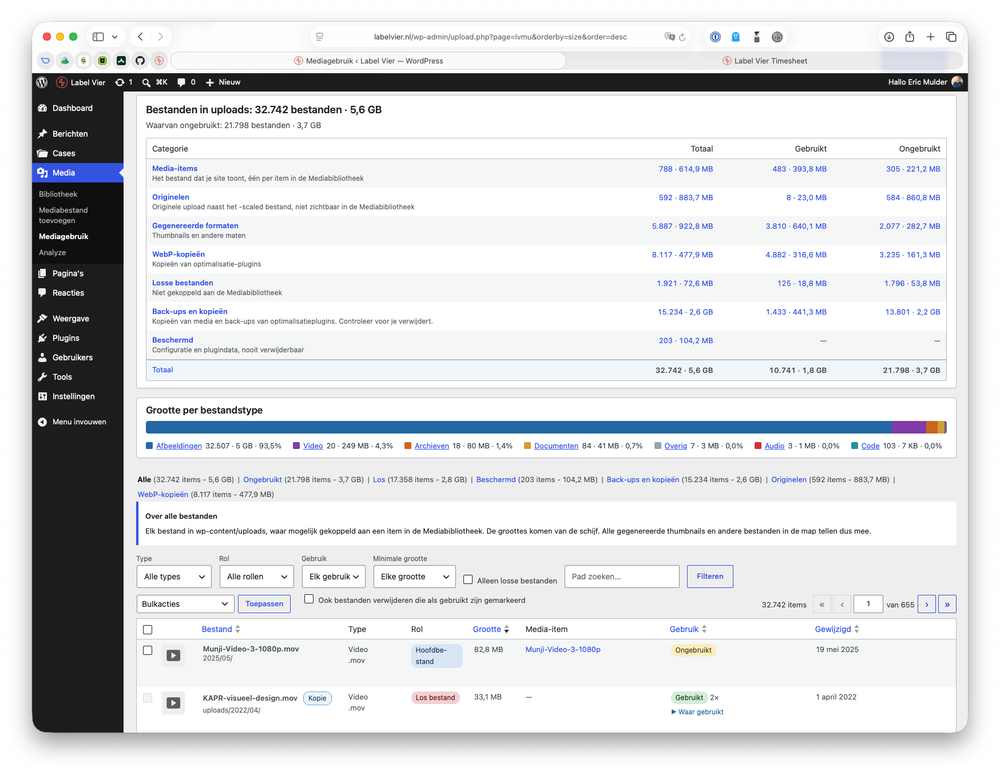

# Label Vier Media Usage

Find out what is really in your `wp-content/uploads` folder, what your site still uses and
what can be deleted safely.



## The problem

Media Library size plugins only look at attachment metadata. They miss everything in
`uploads` that is not (or no longer) a Media Library item: leftover zips, sql dumps and
logs, orphaned thumbnails, WebP copies, optimizer backups and copies of whole upload
folders after a migration. They also cannot tell whether a file is still referenced.

**Label Vier Media Usage indexes every file in the uploads folder, links files to Media
Library items and checks the whole database for real references.** The result is an
overview per category with the size you can reclaim, and a safe way to bulk delete.

## Features

- **Media only in wp-admin**: images, video, audio and documents. Other files in uploads
  (archives, database dumps, logs, code) and protected files are not shown to the client;
  WP-CLI still lists all file types.
- **Size of the site**: media, database and "plugins and system" (plugins plus 300 MB for
  WordPress and the theme), measured in the background. Only sizes are shown, not the database or plugin files.
- **Overview by category**: media items, originals, generated sizes, WebP copies, loose
  files, backups and copies. Each with a count, size and how much is unused.
- **Usage detection** across the whole database (every table with the WordPress prefix):
  post content and blocks, galleries, featured images, ACF image/file/gallery fields,
  page builder data, widgets and options, site icon and logo, plus references from theme
  files and from text files in uploads (css, html, js, svg), so a font or image that is
  only used by a stylesheet counts as used.
- **Originals**: the full size upload WordPress keeps next to `-scaled` is tracked
  separately and only counts as used when it is referenced directly.
- **WebP copies** made by optimizer plugins (`foo.jpg.webp`, `foo.webp`).
- **Backups and copies**: optimizer backup folders and nested copies of the uploads
  structure are recognised and flagged.
- **Protected files** (server configuration, folder protection, dotfiles and plugin data)
  can never be deleted.
- **Suspicious PHP and script files** in uploads are flagged "Check this file".
- **Scheduled bulk deletes** that run in the background, one at a time, with progress,
  cancel, resume after an aborted request and a watchdog for stalled jobs.
- **Nightly index** at 03:00 (site time) through Action Scheduler.
- **WP-CLI** commands for indexing and reporting.
- **Dutch translation** (nl_NL) included.

## Requirements

- PHP 8.1 or higher
- WordPress 6.4 or higher
- A single site installation. Multisite is not supported (files of other sites would be
  reported as unused), the plugin disables itself and shows a notice.

## Installation

1. Download `labelvier-media-usage.zip` from the
   [latest release](https://github.com/labelvier/labelvier-media-usage/releases/latest).
2. In wp-admin go to **Plugins → Add New → Upload Plugin**, upload the zip and activate.

Do not use the "Source code" archives of GitHub: they do not contain the release build.

Updates are installed automatically through the normal WordPress updates screen: the
plugin checks the GitHub releases of this repository and shows the changelog in
"View version x details". To turn this off, see the `lvmu_update_checker_enabled` filter.

## Usage

Open **Media → Media Usage** in wp-admin (requires the `manage_options` capability).

- **Index now** starts an index run through Action Scheduler. The page shows progress
  and reloads when done. While the page is open it also processes the queue itself, so
  runs finish on hosts where the Action Scheduler loopback request is blocked.
- A run is scheduled every night at 03:00 (site time).
- Filter on type, role, usage, orphaned and size. Bulk delete works on the selection or
  on all files matching the current filters. Files marked as used are only deleted when
  "Also delete files marked as used" is checked.
- Bulk deletes run in the background: they are scheduled through Action Scheduler and
  listed at the top of the page, with a **Cancel** link as long as a job has not started.
  Running jobs show their progress, finished jobs show the result (deleted, freed, skipped)
  and can be dismissed. A job waits while an index run is active. Files in a scheduled job
  are marked and cannot be selected again. Jobs run one at a time, oldest first. A job
  remembers which files are still to do, so it resumes where it stopped when a request is
  aborted or PHP dies. A watchdog (every ~2 minutes and on every status poll) restarts a job
  that made no progress for 3 minutes, or a queued job without an Action Scheduler action; after
  3 failed restarts the job is marked failed. A stalled job shows **Resume now** and **Cancel**.
  Status polls keep running a job even when the browser closes the connection. Deleting a single file from its row stays immediate.

### File roles

| Role | Meaning |
|---|---|
| main | The attached file of a Media Library item (often `-scaled`) |
| original | `original_image`, the full size upload WordPress keeps next to `-scaled` |
| subsize | Generated image sizes |
| webp | `.webp` copies made by optimizer plugins (`foo.jpg.webp`, `foo.webp`) |
| orphan | Not part of any Media Library item |

### What counts as "used"

A file is used when its path or filename is referenced anywhere in the database (all
tables with the WordPress prefix), or when its Media Library item is referenced by id
(blocks, `wp-image-123`, galleries, featured image, ACF image/file/gallery fields,
site icon/logo, media-ish option and meta keys). All files of a used Media Library item
count as used, except the original: WordPress serves the `-scaled` file, so an original
is only used when it is referenced directly. Deleting an unused original keeps the
Media Library item working: regenerating thumbnails falls back to the `-scaled` file,
the image editor already works on the `-scaled` file, and the frontend never uses the
original. What you lose is the full resolution file itself (e.g. for downloads or
print) and the ability to generate sizes larger than the `-scaled` file (default max
2560px on the longest side). Revisions, trashed posts and "uploaded to" do not count
as usage.

Not detected: references in plugin code, external sites or newsletters. Check before
deleting files that might be linked from outside the site.

## Protected and suspicious files

Some files can never be deleted, not even with "Also delete files marked as used". They
stay in the list with their size and a "Protected" badge, but cannot be selected:

- Server configuration: `.htaccess`, `.htpasswd`, `.user.ini`, `php.ini`, `web.config`
  and files with the extension `ini`, `conf` or `config`.
- Folder protection: `index.php`, `index.html`, `index.htm`.
- Hidden files: every file whose name starts with a dot (such as `.DS_Store`).
- Plugin data: every file in a folder outside the WordPress `YYYY/MM` structure (for
  example `wc-logs/`, `gravity_forms/`, `elementor/css/`, `some-plugin-cache/`). These
  files belong to plugins, clean them up through the plugin itself. Files directly in the
  uploads root follow the normal rules.

PHP and script files (`php`, `php3`-`php8`, `phtml`, `phar`, `cgi`, `pl`, `py`, `sh`) are
not protected but flagged "Check this file": in uploads they can be a sign of a hacked
site. They can be deleted under the normal rules, after an extra warning in the confirm
dialog. The views "Protected" and "To check" list both groups.
Files in copy folders are not protected, see below.

Sites can extend the rules in code with the `lvmu_protected_patterns` filter (keys
`names`, `extensions` and `folders`). The rules live in `includes/FileRules.php`.

## Backups and copies

Some folders outside the `YYYY/MM` structure are not plugin data but copies of media. They
get the flag `copy` (category "Backups and copies" in the overview, badge "Copy" or
"Back-up") and can be deleted when unused, after an extra confirmation. Files that are
still referenced (old URLs) stay locked unless "Also delete files marked as used" is
checked. Files with an unknown usage are never deleted.

- `media_copy`: a path that does not start with `YYYY/MM/` but contains a `YYYY/MM/file`
  segment. Regex: `^(?!\d{4}/\d{2}/)(.+/)\d{4}/\d{2}/[^/]+$`. Examples:
  `uploads/2022/03/x.jpg` (nested uploads after a migration),
  `ShortpixelBackups/wp-content/uploads/2022/03/x.jpg`, `sites/2/2020/01/x.jpg`,
  `old-uploads/2019/05/x.jpg`. On a multisite, `sites/N/` is never treated as a copy.
- `optimizer_backup`: any folder named like an entry of the folder list, at any depth.
  Default list: `ShortpixelBackups` (source: ShortPixel knowledge base, "Where is the
  backup folder located": `wp-content/uploads/ShortpixelBackups`). Not included because the
  name could not be confirmed as a distinct uploads folder: Imagify stores its backups in
  `uploads/backup/YYYY/MM` (covered by the `media_copy` regex), EWWW keeps them in
  `wp-content/ewww` (outside uploads) and for Smush no folder name was found.
- Never a copy: protected names (`.htaccess`, `index.php`, ini/conf, dotfiles) and the
  protected plugin folders (`updraft`, `ai1wm-backups`, `backwpup-*`, `wc-logs`,
  `woocommerce_uploads`, `gravity_forms`, `wpforms`, `wp-migrate-db`).
- Precedence: protected by name/extension/dotfile, then copy, then plugin folder rule, then
  suspicious. Copies with a PHP or script extension also show the "Check this file" badge and
  count in the "To check" view.
- The flags are recomputed for all rows when the database version changes (now 3).

Filters: `lvmu_copy_folders` (array of folder names, fnmatch globs allowed) and
`lvmu_protected_patterns` (see above). The rules live in `includes/FileRules.php`.

## Safety

- Protected files are never deleted, see [Protected and suspicious files](#protected-and-suspicious-files).
- Files with an unknown usage are never deleted.
- Files marked as used are only deleted when "Also delete files marked as used" is checked.
- Only files from the latest complete index are deleted, and before a file is deleted the
  plugin checks again that it is not referenced since that index run.
- Backups and copies and PHP/script files need an extra confirmation.
- Always make a backup before a large bulk delete.

## WP-CLI

```bash
# WP-CLI shows every file type in uploads (wp-admin shows media only); protected files are never listed.
wp lvmu index --sync          # run a full index inline
wp lvmu index                 # queue a run in Action Scheduler
wp lvmu status
wp lvmu summary
wp lvmu list --orphaned --usage_status=unused --limit=50
wp lvmu size                  # uploads + database + plugins + 300 MB for core and themes
```

`wp lvmu summary --format=json` prints the full summary including the reclaimable size.

`wp lvmu size --format=json` prints the size of the site in bytes:
`uploads` (the whole uploads folder), `database` (all tables with the WordPress prefix),
`plugins`, `base` (a fixed 300 MB for core and themes) and `total`. The Label Vier
dashboard uses this to show storage usage per site.

## Hooks

| Hook | Type | Purpose |
|---|---|---|
| `lvmu_update_checker_enabled` | filter | Return `false` to disable update checks against GitHub (default `true`). |
| `lvmu_protected_patterns` | filter | Extend the protected rules (keys `names`, `extensions` and `folders`). |
| `lvmu_copy_folders` | filter | Folder names (fnmatch globs allowed) that are treated as optimizer backups. Default `['ShortpixelBackups']`. |
| `lvmu_ref_scan_skip_tables` | filter | Regex list of tables the usage scan skips. |
| `lvmu_site_size_base_allowance` | filter | Bytes added to the measured size for core and themes in `wp lvmu size` (default 300 MB). |
| `lvmu_ref_scan_error_tolerant_tables` | filter | Regex list of tables for which unreadable rows do not fail the scan. |
| `lvmu_deleted_files` | action | Fires after a delete run with the result (deleted, freed, skipped). |

Example:

```php
add_filter('lvmu_protected_patterns', function (array $patterns): array {
	$patterns['folders'][] = 'my-plugin-cache';
	return $patterns;
});
```

## Development

This plugin is developed in the Label Vier WordPress starterkit repository, in
`wp-content/plugins/labelvier-media-usage/`. This repository is a read-only mirror of
that folder (`git subtree split`), so open issues here but expect fixes to arrive through
the starterkit. Action Scheduler and Plugin Update Checker are bundled with composer in
`vendor/` (committed).

In the starterkit root:

- `npm run build` copies a clean plugin to `build/labelvier-media-usage/` and creates
  `build/labelvier-media-usage-<version>.zip` (version from the plugin header). The
  `.github` folder, composer files and dotfiles are left out of the zip.
- `npm run i18n` and `npm run i18n:check` maintain the translations, see below.
- Test data: `bin/seed-media-usage.sh`, expected results in `test/fixtures/EXPECTED.md`.

### Releasing

1. Bump `Version` in the plugin header and `LVMU_VERSION` in `labelvier-media-usage.php`
   and add a `## [x.y.z] - date` section to `CHANGELOG.md`. Commit everything.
2. Run `npm run release:plugin -- --dry-run` to check, then `npm run release:plugin`.

The script verifies the version and changelog, runs the translation check and the build,
requires a clean working tree, pushes the plugin folder to the `main` branch of
`labelvier/labelvier-media-usage` (`git subtree split`), tags `vX.Y.Z` and creates the GitHub
release with `labelvier-media-usage.zip` attached. The release notes are the matching
section of `CHANGELOG.md`; installed sites show them in the update details screen.
Environment: `PLUGIN_REPO` (remote URL), `FORCE=1` (force push). Needs the `gh` CLI.

## Translations

All UI text must be translatable (text domain `labelvier-media-usage`) and fully
translated to Dutch (nl_NL). The source language is English.

1. After changing strings, run `npm run i18n`. It regenerates the `.pot`, merges it
   into the `.po` and rebuilds the `.mo` and `.l10n.php` (needs the Docker container).
2. Fill in the empty Dutch `msgstr` entries in `languages/labelvier-media-usage-nl_NL.po`
   in Label Vier tone (je/jij), and remove any `fuzzy` flags. Run `npm run i18n` again to rebuild the `.mo`.
3. Run `npm run i18n:check`. It fails on new msgids missing from the `.po`, empty or
   fuzzy translations and a `.mo` older than the `.po`.

`npm run build` refuses to build when translations are incomplete
(override with `SKIP_I18N_CHECK=1`).

## License

GPL-2.0-or-later, see [LICENSE](LICENSE).
